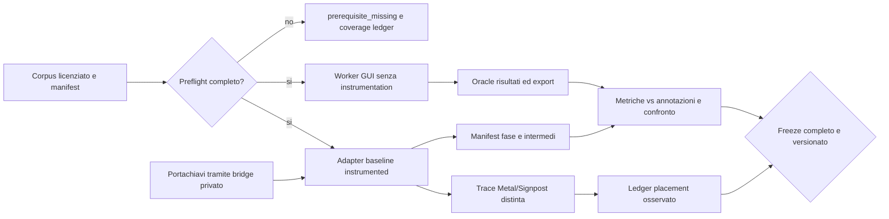

# Phase 1: Baseline, contratti e prove GPU — Research

**Researched:** 2026-10-12  
**Domain:** oracle della GUI MLX/MPS, contratti brownfield, qualità e profiling Metal.  
**Confidence:** MEDIUM per implementazione proposta; fonti locali verificate staticamente. Nessun test, inferenza o download eseguito.

<user_constraints>
## User Constraints (from CONTEXT.md)

### Locked Decisions e discrezione
### Obiettivo bloccato dall'utente
- Spostare sulla GPU tutta la computazione numerica portabile; C++, Objective-C++, Metal e riscritture estese sono autorizzati come direzione del piano.
- Conservare diarizzazione community-1, numero voci automatico/esatto, overlap e attribuzione segmenti/parole.
- Conservare profili base/small/large-v3 completo e qualità; un confronto con modello diverso non costituisce parità.
- whisper.cpp nel repository personale è read-only reference, mai dipendenza di release dal percorso personale.

### Baseline e contratti
- Registrare SHA completo, versioni di runtime e modelli/revision/hash, impostazioni reali e hardware in manifest sanitizzati.
- Distinguere GUI MLX da CLI CTranslate2 e da whisper.cpp reference; non eseguire un altro checkout pensando sia la baseline GUI.
- Congelare result/schema/events/export/language/word/speaker e scenari library/Keychain/errore/cancellazione; non modificare catalogo o media personali per ottenere fixture.
- Usare fixture sintetiche/versionabili e corpus autorizzato con licenze esplicite. I test sintetici non certificano WER o DER naturale; senza annotazione un oracle dà parità, non accuratezza.
- Test nativi, modelli convertiti e framework futuri non sono prerequisiti della fase 1. Tool baseline può usare Python del runtime esistente in sviluppo, senza installazioni globali o modifica della produzione.

### Misure e qualità
- Profiling deve separare enqueue, completamento GPU, CPU compute, copie/readback, attese, cold/warm e download.
- Disponibilità Metal/MPS non è evidenza d'inferenza; trace/backend osservato è collegato a run ID e fase.
- Casi mancanti e fallback sono visibili; il ledger deve rilevare un caso intenzionalmente non coperto.
- Definire metriche e metodo di calibrazione/freeze prima di promuovere nuovi backend: WER/CER, timestamp coverage/start/end, DER/JER e speaker count, policy overlap/collar/permutazione label.
- Non inventare soglie o speedup sulla base della sola lettura sorgenti. Pianificare raccolta e congelamento delle soglie con manifest/artefatti e divieto di retuning per far passare un candidato.
- Token gated assente o modello non disponibile è una precondizione/esito esplicito, non una prova simulata di qualità o GPU; niente token argv/env/file. Preferire uso del percorso Impostazioni corrente e dei modelli locali autorizzati.

### Git e workflow
- NO commit/push/tag/branch/worktree automatici, anche se il workflow standard li prescrive.
- Non sovrascrivere AGENTS.md, istruzioni, source work preesistente o il checkout whisper.cpp.
- Pianificare ogni test/command con tool/runtime reali o infrastruttura Wave 0 esplicitamente prevista; non usare test che specchiano soltanto l'implementazione.

### Discrezione dell'agente
- Organizzazione di tools/tests/fixture e numero di piani da 2–3 task ciascuno; granularity fine.
- Metriche e normalizzazioni esatte, sampling della trace e selezione corpus rappresentativo documentati nel contratto, con soglie ancora da congelare dopo misure.
- La conversione produttiva senza Python appartiene alla fase 2. In fase 1 si inventariano formati/config e si identifica un proof-of-conversion minimo solo se non confonde la responsabilità o richiede download estesi.

### Deferred Ideas (OUT OF SCOPE)
Core nativo e helper (fase 3), porting feature/modelli/kernel (fasi 4–9), wiring app e installer (10–11). Nessun residuo numerico è rinviato a v2.
</user_constraints>

## Project Constraints (from AGENTS.md)

[VERIFIED: AGENTS.md e istruzioni utente] Nessun commit/push/tag/branch/worktree automatico, incluso questo artefatto. Preservare tutto il lavoro preesistente. App installabile con doppio click senza setup manuale Python/FFmpeg. Hugging Face solo nel pannello Impostazioni omonimo, con Modelli e Libreria; token nel Portachiavi, mai argv/log/file del progetto; niente hosting proprio/token condivisi. Toolbar con titolo/player/azioni, Nuova cartella nel menu File Cmd+Shift+N. Relocation della libreria trasferisce gestiti e rimuove catalogo precedente solo dopo verifica, senza backup residui; esterni intatti. Nessuna modifica UI in questa fase. Commenti senza interruzioni a metà frase; argomenti fra parentesi sulla stessa riga. Non toccare knowledge base o script personali: non necessari a questa fase. Se in altra attività si usasse aitranscribe, obbligatorio --no-llm-check.

[VERIFIED: discovery locale] Non sono state trovate directory di skill progetto .codex/skills o .agents/skills. La produzione e le API legacy restano inalterate; tools baseline sono strumenti di sviluppo separati.

<phase_requirements>
## Phase Requirements

| ID | Descrizione | Supporto ricerca |
|---|---|---|
| BASE-01 | Versioni, sorgenti, modelli/hash, hardware, memoria, impostazioni senza credenziali | manifest effettivo, digest del working tree e pin modelli |
| BASE-02 | Corpus/oracle IT/EN, durate, silenzi, overlap, count e famiglie linguistiche | acquisizione licenziata, annotation protocol, fixture/oracle separati |
| BASE-03 | Tempi sincronizzati, memoria, copie/sync e placement, download/cold/warm | adapter nonproduction, misure strutturate e trace reali |
| BASE-04 | Calibrazione/freeze WER/CER, tempi, DER/JER e speaker policies | contratto versionato, split indipendenti e gate fail-closed |
</phase_requirements>

## Summary

[VERIFIED: macOS/Worker/transcribe_worker.py] La baseline primaria deve chiamare il worker GUI: MLX Whisper su Metal se disponibile, Wav2Vec2 su MPS, community-1 su MPS e postprocessing corrente. CLI CTranslate2 e whisper.cpp sono reference distinti. I tre profili MLX, condition_on_previous_text=False, initial_prompt, lingua auto/esplicita, conteggio min=max e warning opzionali sono semantica da catturare.

**Raccomandazione progettuale:** implementare tools/baseline/ come harness di sviluppo che esegue il worker originale, registra un oracle di risultati e abilita instrumentation temporanea dentro il solo processo benchmark. Primo gate: parità del risultato rispetto al worker senza instrumentation. Tenere separati contratto sintetico, qualità annotata, parità oracle e prova placement. Nessun nuovo core nativo, modello convertito o modifica della produzione in fase 1.

[VERIFIED: RuntimeManifest.json, cache standard e requisiti] Python bundled e dipendenze baseline sono presenti; disponibilità dei tre modelli MLX, alignment e community-1 non provata. La cache standard ispezionata contiene faster-whisper-medium, insufficiente per baseline GUI. Token non letto. Pianificare provisioning autorizzato e annotazioni prima delle run full; una mancanza restituisce prerequisite_missing e impedisce freeze completo. Non sostituire dati reali con mock per dichiarare BASE-02..04 soddisfatti.

## Architectural Responsibility Map

| Capacità | Owner | Supporto | Ragione |
|---|---|---|---|
| Config/credenziali | App Swift/Portachiavi esistente | pipe privata del harness | riprodurre percorso autorizzato |
| Inferenza baseline | worker GUI e dipendenze pinned | adapter sviluppo | preservare semantica |
| Manifest/ledger | tools/baseline stdlib | runtime metadata/cache | artefatti sanitizzati e verificabili |
| Oracle intermedi | adapter sviluppo | hook scoped a APIs reali | confronto future implementazioni |
| Annotazioni/metriche | corpus manifest e evaluator | pyannote.metrics | accuratezza distinta da parità |
| Placement | Instruments/Metal capture | marker fase/run ID | prova del dispatch, non disponibilità |

La tabella è una proposta di responsabilità; non certifica componenti già costruiti.

## Standard Stack

[VERIFIED: requirements.lock e RuntimeManifest.json] Non aggiornare/installare pacchetti in fase 1. Usare Python 3.12.12 bundled, MLX 0.32.2, mlx-whisper 0.4.3, Torch 2.8.0, pyannote.audio 4.0.4, pyannote.metrics 4.1, NumPy 2.2.6, SciPy 1.15.3; versioni installate da rilevare con importlib.metadata e confrontare con lock. Il lock identifica intent, non prova versione loaded. Xcode/Swift Testing esistenti per contratti app, unittest stdlib per nuovi test Python. pytest è extra dev nel pyproject e non rilevato nel runtime installer: non prescrivere uv run che può risolvere/scaricare dipendenze.

### Package Legitimacy Audit

Non applicabile a nuove installazioni: nessun pacchetto esterno nuovo proposto. Non spacciare lock storico per legitimacy audit attuale. Il provisioning corpus deve usare download mirati con tooling bundled/stdlib; non aggiungere datasets o jiwer implicitamente. Per edit distance WER/CER usare un piccolo scorer deterministico testato con casi analitici; DER/JER e Hungarian mapping riusano pyannote.metrics/SciPy già inclusi.

## Architecture Patterns

### Flusso



### Struttura proposta

- tools/baseline/run.py: argparse separato da orchestrazione; comandi preflight, provision, run, evaluate, freeze/verify-freeze.
- tools/baseline/adapter.py: importa worker selezionato esplicitamente; patch scoped per sole misure, ripristino in finally.
- tools/baseline/manifest.py, corpus.py, metrics.py, profiling.py, contracts.py: responsabilità separate.
- tests/baseline/test_manifest.py, test_contracts.py, test_corpus.py, test_metrics.py, test_profiling.py, test_freeze.py: unittest senza GPU/download.
- tests/fixtures/baseline/: audio sintetico generato, JSON/IPC/export/CTC/distance fixture compatte e licenze.
- evaluation/baseline/: corpus manifest, annotation protocol, evaluation contract e coverage matrix versionabili; media naturali e run output in percorso locale esplicito escluso da Git.
- docs/BASELINE_GPU.md: comandi, corpus acquisition, trace review, limiti e freeze.
- Eventuale tools/baseline/credential_bridge.swift solo sviluppo: legge servizio Portachiavi corrente e scrive richiesta token a pipe privata, senza nuovo pannello UI.

### Baseline primaria e adapter

[VERIFIED: worker main/run, TranscriptionEngine.swift] La GUI lancia Python -I -B -u e worker bundled; worker seleziona sorgenti dalla directory Resources. run(request) importa whisperx e scrive original.json, aligned.json quando ci sono segmenti, result.json e TXT/SRT/VTT. Eventi stdout NDJSON: stage, completed, failed. Schema effettivo permette parole prive di tempi nei casi non allineabili: fixtures devono ricavare questi casi dalla logica corrente, non imporre score/start/end obbligatori solo perché TypedDict li mostra.

**Prescrizione:** selezionare explicit baseline-source=gui-checkout oppure gui-bundle e registrarlo. Se checkout, inserire path via entry script anche con -I; hash worker, whisperx e dipendenze importate, non solo HEAD. GUI checkout è largamente untracked in questo stato: SHA 771b4a14a9486f8fd5aef18ef49e35d639523dd3 non identifica da solo l'oracle. Reference whisper.cpp: 21411d81ea736ed5d9cdea4df360d3c4b60a4adb, read-only.

**Prescrizione:** chiamare worker.run nella sandbox harness, intercettare emit per duplicare gli eventi semantici su file sanitizzato e registrare spans separati. Le wrapper di load_audio, mlx_whisper.transcribe, load_align_model/align, DiarizationPipeline.__call__, assign_word_speakers e writer osservano gli stessi input/output e non cambiano batch/device/seed. Hook più fini in process-only per get_trellis/backtrack, loader e pipeline hook pyannote quando presente; mai assumere default di classe uguali alla config caricata. Togliere instrumentation per oracle primary e confronto finale. Un adapter che duplica run senza confronto drift diventerebbe un'altra pipeline.

**Oracle intermedio:** dump opt-in di feature/emissioni/trellis/path, segmentazione/embedding e cluster solo su corpus autorizzato; hash, shape, dtype, stage/run ID, revision. Quando hook pubblico non permette extraction affidabile, segnare intermediate_unavailable e task investigativo, senza implementare kernel futuri. Dump impone eval/readback e altera tempi: usarlo in run diagnostica separata. Mai salvare token o request raw.

### Manifest e prerequisiti

**Prescrizione:** usare allowlist strutturata: run/case ID; source SHA + dirty/content digest; lock/runtime-manifest/hash e installed metadata; hardware chip/RAM/GPU/OS/SDK; modello repo, revision completa/hash pesi/config/vocab/PLDA; input hash/durata/sample-rate/channel; profilo/backend/precision/options; cache-state; stato per fase/error code/fallback; strumenti trace e metric contract hash.

[VERIFIED: StorageInventory.swift e WorkerRuntime.swift] Cache roots comprendono HF_HUB_CACHE/HUGGINGFACE_HUB_CACHE/HF_HOME, XDG_CACHE_HOME e TORCH_HOME; cercare esclusivamente roots reali e file dichiarati, risolvere symlink e deduplicare blobs. Non esportare env completo, path home, token cache o config credenziali. Registrare logical paths/cache ID e hash dei file effettivamente usati. Preflight non chiama loaders che scaricano; trova pesi locali/config oppure restituisce lista gap. Shapes/formati e config modelli gated vanno inventariati se disponibili; conversione produttiva è fase 2.

## Corpus e acquisizione eseguibile

[CITED: https://huggingface.co/datasets/google/fleurs] FLEURS ha trascrizioni e licenza CC-BY-4.0; è corpus di parlato letto, non prova naturale di conversazioni/speaker overlap. **Prescrizione:** scegliere deterministicamente un sottoinsieme IT/EN più fr/de e rappresentanti ja/zh, ar, uk e no per famiglie senza spazi/XLSR/XLS-R/1B; snapshot e file IDs congelati. Download soltanto file necessari da endpoint ufficiale, checksum e attribution salvati. Non presupporre mapping completo: leggere DEFAULT_ALIGN_MODELS_TORCH/HF e lingue UI, coverage per tutte le righe con represented/untested.

[CITED: https://groups.inf.ed.ac.uk/ami/download/] AMI fornisce audio e annotazioni tramite pagina ufficiale. **Prescrizione:** acquisire un meeting inglese lungo e ritagli brevi/overlap solo dopo acquisizione della licenza esatta dell'asset e permessi di derivazione/versionamento; se licenza non verificata, niente download/uso/certificazione AMI. In questa ricerca la pagina licence non è stata letta con successo: AMI è candidato di acquisition, non corpus già autorizzato. Manifest missing_license deve bloccarne l'uso.

**Prescrizione:** per IT conversazionale/overlap naturale senza sorgente licenziata già verificata, selezionare materiale pubblico con licenza esplicita attraverso task dedicato di acquisizione e verifica, scaricare revision/hash, quindi annotare manualmente speaker turns, overlap, UEM e tempi parola su sottoinsieme. Non usare registrazioni personali. Se sorgente/annotatore manca, status prerequisite_missing=italian_natural_diarization_ground_truth; BASE-02/04 full non completabili finché risolto. La task deve consegnare file e registri veri, non solo una lista di URL.

**Annotation protocol:** preservare raw transcript; normalizzazione versionata; RTTM/JSON turns con speaker anonimi e UEM; JSON parole start/end, confidence umana e unresolved. Secondo controllo manuale dei confini/overlap campionati e adjudication degli incerti; registrare annotatore anonimo, revisione e origine. Non usare output baseline come ground truth. Allineamento automatico può suggerire, ma la revisione umana deve essere esplicita.

**Copertura minima progettuale:** tutti tre profili reali; auto/explicit IT/EN; hints/no hints; voices off/auto/exact; breve/lungo, silence/non-speech, overlap, fallimento modello/token, unknown chars/fuori range, finestre e boundary; rappresentanti lingue/famiglie. Separare synthetic_contract, derived_audio, natural_annotated e parity_only. Concatenazioni/mix FLEURS danno stress derivato con ricetta/durata/hash, mai DER naturale certificato. L'audio lungo naturale non è sostituibile da sinusoide ripetuta. Coverage ledger atteso-generato, non generato dai soli casi presenti.

### Provisioning senza segreti

**Prescrizione:** 1) preflight elenca pesi/config/access/corpus mancanti senza leggere segreti; 2) per community-1 usare Impostazioni HF attuali per token/accettazione, poi bridge sviluppo legge Portachiavi e invia soltanto via stdin privata; 3) provision esplicito carica modelli richiesti separatamente con runtime bundled e revision da registrare, rete solo acquisition; 4) scaricare corpus sotto licenza/manifest autorizzato; 5) annotare; 6) ripetere preflight full e bloccare run se manca qualsiasi gate richiesto. Nessun token argv/env/request-file. Non usare security find-generic-password -w nel Terminale. Non cancellare cache condivise per simulare primo download. Cache isolata di benchmark può essere creata solo per asset consentiti, con budget e cleanup espliciti.

## Profiling e placement

[VERIFIED: mlx/core stubs, torch/mps/__init__.py e profiler.py bundled; CITED: https://ml-explore.github.io/mlx/build/html/python/_autosummary/mlx.core.synchronize.html; https://docs.pytorch.org/docs/2.8/generated/torch.mps.synchronize.html] Entrambi i runtime espongono synchronize. Torch profiler wait_until_completed=True altera le prestazioni: diagnostic trace e benchmark ordinario devono avere run ID distinti. MLX synchronize sul default stream non prova drain di stream nondefault: censire stream usati e drain esplicito.

**Misura per fase:** drain preesistente; t_start; call_return; eval dei risultati lazy prima del drain; drain backend coinvolti; t_complete. Salvare API-call wall, post-return wait e completion-wall. API-call wall può contenere CPU compute e sincronizzazioni interne: non chiamarlo enqueue-only o GPU-time. CPU process time e profiler/trace separano attività quando osservabile; intervalli si sovrappongono, non sommarli come se disgiunti. Download/load/inferenza/post/export sono spans distinti; log download wall soltanto nella acquisition.

**Memoria:** RSS processo (unità macOS esplicita), campionamento fase; mx.get_active_memory/get_peak_memory/reset_peak_memory e cache; torch.mps.current_allocated_memory/driver_allocated_memory (nessun peak API assunto, campionare e dichiarare lower bound). Registrare come domain counters, non sommare allocazioni unificate MLX+MPS+RSS in un totale fittizio.

[VERIFIED: alignment.py:271; diarize.py:167] Allineamento porta emissions sulla CPU; diarize legge speaker_diarization regolare. Ledger distingue tensor logical bytes/readback dalla copia fisica: memoria unificata non implica zero transizioni/attese. Per ogni evento: placement static_expected, observed_dispatch/CPU/unknown, trace interval/operator/pipeline, bytes logical se calcolabili, physical_bytes=null se non osservabili. Fallback assente/non misurato non equivale zero.

**Prescrizione trace:** run diagnostica isolata su corpus pubblico breve per ASR/align/diar; Instruments Metal System Trace o MLX .gputrace/MPS capture supportato. Registrare run ID/PID/case/phase boundaries e hash trace; revisione manuale identifica dispatch, CPU CTC/clustering e transizioni/readback. GPU busy time da trace, non wall timer. Profiler cambia scheduling: non usarlo per baseline throughput primaria. Trace può contenere input buffers, mantenerla locale anche per corpus autorizzato; sanitizer dei JSON non sanifica automaticamente la trace.

**Download/cold/warm:** download separato; cold-process=new worker con pesi già locali e cache filesystem dichiarata; warm-cache=new processo dopo cold, con cache filesystem popolata. Il worker resetta ModelHolder e clear_cache dopo ASR: non chiamare warm-model il secondo job GUI. Eventuale warm-model sperimentale adapter è scenario distinto senza confronto produttivo primario. Repliche, ordine randomizzato controllato, thermal/power/load e descrizione hardware fissati prima della raccolta.

## Metriche, calibrazione e freeze

[CITED: https://pyannote.github.io/pyannote-metrics/reference.html; VERIFIED: pyannote/metrics/diarization.py bundled] DER/JER disponibili; DER usa mapping Hungarian e include overlap salvo skip_overlap. **Prescrizione:** primary DER/JER collar=0, skip_overlap=False con UEM esplicito; report secondario collar alternativo solo se già dichiarato. Usare lo stesso mapping per word-speaker comparison, senza cambiare label testuali in export. Count error e unassigned coverage separati.

**Evaluation contract proposto:** WER su tokenizzazione language-aware e CER Unicode-normalizzato, raw e normalizzato distinti; replacement punctuation/numerals/whitespace documentati, mai normalizzazioni ad hoc sul candidato. Timestamp start/end MAE e p50/p95 su parole referenziate matched, coverage su tutte le parole reference, exclusions e missing; niente metrica solo sulle parole facili allineate. Lingue senza spazi CER primaria, WER soltanto con tokenizer policy esplicita. Silenzio senza reference: insertions e seconds hallucinated, WER denominator zero restituisce not_applicable/errore distinto. DER/JER con turns/UEM; speaker-count distribution; permutation-aware word speaker accuracy con denominatore e ambiguity policy overlap dichiarati.

**Calibrazione:** split calibration/evaluation disgiunti per sorgente/speaker, selezione deterministica prima della baseline; ripetizioni pinned misurano variabilità; bootstrap per recording con seed, non per parole correlate; report per language/quality/overlap/duration. Definire margini in base alla variabilità e obiettivo conservare qualità, documentando rationale e campioni; nessun numero inventato in piano. Se campioni insufficienti, fail freeze come insufficient_ground_truth. Non congelare soltanto meccanismo senza valori misurati.

**Freeze:** evaluation-contract.json version/hash, corpus/license/annotation hashes, baseline run IDs, runtime/model SHA, normalizzazioni, collar/overlap/mapping, margini e hardware budget, data/versione, coverage completeness. Stato draft -> calibrated -> frozen, con freeze che rifiuta null/missing/NaN/casi obbligatori scoperti e prerequisite_missing. Modifica deliberata del corpus/policy crea nuovo contract ID e invalidazione confronti precedenti; nessun retuning per far passare un candidato. Il ledger deve fallire un test con caso obbligatorio intenzionalmente rimosso e operatore required senza observed evidence.

## Don't Hand-Roll

| Problema | Riutilizzare | Motivazione |
|---|---|---|
| Pipeline di riferimento | worker e funzioni attuali | non creare oracle differente |
| DER/JER e label matching | pyannote.metrics/SciPy bundled | edge case overlap/UEM/permutation |
| Custodia token | TokenVault/Portachiavi | niente file/env/client custom |
| Protocollo/export | schema, writers e decoder attuali | contratti brownfield |
| Metriche/test Python baseline | unittest/importlib/argparse stdlib | nessun setup globale |

## Runtime State Inventory

| Categoria | Stato verificato o limite | Azione pianificata |
|---|---|---|
| Stored data | LibraryStore usa Library.json versione 1, Media/UUID e Projects/revision; non ispezionati dati reali [VERIFIED: LibraryStore.swift] | fixture temporanee, zero migrazione reale |
| Live service config | HuggingFaceConnection usa whoami-v2 e HEAD gated config; access account non verificato [VERIFIED: Swift] | preflight access autorizzato; niente alterazione servizi |
| OS-registered state | servizio Keychain it.whisperx.mac.huggingface/user-token [VERIFIED: TokenVault]; nessun launch agent ricercato perché fase non rinomina app | preservare servizio; bridge development non cambia registrazioni |
| Secrets/env | token via pipe; env filtrato HF_/HUGGING_FACE/PYTHON/DYLD, cache vars allowlisted [VERIFIED: WorkerRuntime] | test fake secrets e sanitizzazione; non leggere env raw |
| Build artifacts | installer runtime/worker/whisperx bundled e RuntimeManifest presenti; checkout personale reference [VERIFIED: file locali] | hash/select baseline explicit, non rebuild/replace; nessun release artifact nuovo |

## Common Pitfalls

- **SHA insufficiente:** sorgenti untracked/dirty non coperte da HEAD. Hash contenuti importati e protocollo.
- **Warm sbagliato:** cleanup modello nel worker; distinguere warm-cache da warm-model.
- **Ritorno API = GPU conclusa:** inserire drain documentato e distinguere trace/tempo wall.
- **Synthetic come ground truth naturale:** test contratti non dimostrano accuratezza.
- **Fallback invisibile:** warning genericamente catturati dal worker; adapter registra stage outcome sanitizzato senza inferire success.
- **Trace/dump come benchmark:** instrumentation aggiunge sync/readback; run separate.
- **Lingue mancanti:** selezione rappresentativa non basta a release globale; ledger conserva tutti i mapping.
- **Segreti nei dettagli eccezione:** emit failed redige token globale, ma logger adapter deve redigere prima di persistere con allowlist, inclusi falsi secret sentinel nei test.

Tutti i rischi derivano da sorgenti verificate sopra oppure sono prescrizioni di progetto, non bug riprodotti.

## Code Examples

Pattern proposto, basato sulle API verificate; non è codice già eseguito:

```python
from time import perf_counter_ns

def measure_mps(call):
    torch.mps.synchronize()
    started = perf_counter_ns()
    result = call()
    returned = perf_counter_ns()
    torch.mps.synchronize()
    completed = perf_counter_ns()
    return result, {"api_wall_ns": returned - started, "post_return_wait_ns": completed - returned, "completion_wall_ns": completed - started}
```

Per MLX sostituire drain con mx.synchronize sugli stream censiti e mx.eval sugli output lazy appropriati. Il worker restituisce oggetti Python, non un singolo tensor: selezione outputs/intermedi richiede adapter specifico, non mx.eval indiscriminato del result dict.

## Environment Availability

| Dipendenza | Stato | Evidenza/fallback |
|---|---|---|
| Bundled Python | percorso presente, manifest 3.12.12 | macOS/output/installer/WhisperX.app/Contents/Runtime/bin/python3; preflight futuro verifica esecuzione/import |
| Runtime MLX/Torch/metrics | sorgenti e lock presenti | import/metadata/self-check futuro, nessuna inferenza attestata |
| FFmpeg | manifest 7.1.5 | runtime/bin/ffmpeg, verificare executable nel preflight |
| Xcode/xctrace | xcode-select e path presenti | template Metal System Trace da verificare in esecuzione |
| Hardware | Apple M4 Pro, 24 GiB, macOS 15.6 | sysctl/sw_vers letti; GPU cores/dettagli via capability query futura |
| pytest | non rilevato nel bundle | unittest stdlib nuovi test |
| MLX/Wav2Vec2/community-1 locali | non dimostrati | provisioning esplicito, non altro modello |
| Token/autorizzazioni | non letti | Impostazioni/bridge privato, status missing |
| Corpus naturale annotato | non predisposto in questa ricerca | acquisition/licenze e annotation task obbligatorie |

Dati ambiente [VERIFIED: ricognizione filesystem/sysctl/sw_vers/manifest] salvo stato access/pesi/annotazioni, esplicitamente non verificato. Disponibilità executable non è esito import/smoke positivo.

## Validation Architecture

Nyquist e security abilitati [VERIFIED: config.json]. Comandi **proposti per file Wave 0 da creare**, non test già esistenti/eseguiti:

```bash
macOS/output/installer/WhisperX.app/Contents/Runtime/bin/python3 -I -B -m unittest discover -s tests/baseline -p 'test_manifest.py' -v
macOS/output/installer/WhisperX.app/Contents/Runtime/bin/python3 -I -B -m unittest discover -s tests/baseline -p 'test_*.py' -v
swift test --package-path macOS --filter WorkerRuntimeTests
swift test --package-path macOS
```

Con -I i moduli tools/baseline non sono implicitamente nel sys.path: fixture bootstrap del test runner deve inserire repo root calcolato da __file__; adapter entry script fa altrettanto per worker/source selected. FFmpeg path va derivato dal bundle, non PATH globale.

| Req | Test <30s progettuale | Comando/suite | Prerequisito reale |
|---|---|---|---|
| BASE-01 | manifest rejects secrets/dirty mismatch, runtime selection | test_manifest.py | Wave 0; fixture fake secrets |
| BASE-02 | coverage absent case fails, license missing blocks, fixture export/IPC and orphan words | test_corpus.py + test_contracts.py | Wave 0; nessun peso |
| BASE-03 | timer ordering/drain failure/incomplete trace ledger | test_profiling.py | fake clock/backend solo plumbing |
| BASE-04 | known WER/CER edits, DER/JER permutation/overlap, timestamps missing denominator, freeze mutation | test_metrics.py + test_freeze.py | metrics bundled, dati analitici |
| BASE-01..04 | oracle E2E real + corpus metrics + freeze | run.py/evaluate/freeze futuri | corpus/pesi/access, tempi >30s separati |
| BASE-03 | dispatch Metal per fase, CPU/readback e incompleto intenzionale | trace manuale + ledger check | Instruments e inferenza reale |

Sampling: suite rapida ad ogni task; suite baseline completa e Swift pertinente a wave; trace/corpus soltanto ai gate reali con prerequisiti. Nessun task commit: il repository vieta commit. full suite Swift può superare 30s: non promettere quick per tutte le suite.

Wave 0 gaps: tutti nuovi file tools/tests/fixture sopra; credential bridge se modelli gated non eseguibili via offline snapshot e policy corrente; annotation acquisition/protocol; MLX/MPS instrumentation e ledger; evaluator/freeze. Nessuna validazione Nyquist completa finché planner associa task IDs/file veri e l'esecuzione produce evidenze.

## Security Domain

[VERIFIED: prodotto locale e TokenVault/WorkerRuntime] Applicabilità ASVS come checklist di progetto: autenticazione remota individuale HF/Portachiavi; nessuna sessione web/browser app da implementare; access control su path output sandbox; input validation request/corpus/path/JSON; crittografia delegata HTTPS/Keychain, mai nuova crittografia. I numeri ASVS V2/V3/V4/V5/V6 dipendono dalla versione e non sono qui asseriti come controllo certificato.

| Minaccia | Mitigazione progettuale |
|---|---|
| Token/log/payload persisting | allowlist, fake sentinel leakage tests, pipe private, no request raw |
| Symlink/path traversal e overwrite | output dir dedicata, resolve+containment, esterni sola lettura |
| Pesi/checkpoint non affidabili | ufficiale pinned/hash/licenza, non checkpoint arbitrari |
| Corpus privato accidentalmente catturato | manifest allowlist, reject source personale non autorizzata |
| Trace buffer disclosure | trace locale, input pubblico, separare shareable summary |

## State of the Art

[VERIFIED: sorgenti baseline e research/SUMMARY.md] L'attuale Metal/MPS ibrido è l'oracle brownfield; le fasi successive migrano numerica e preservano algoritmi. Fase 1 non confronta ancora un backend nativo candidato e non produce speedup. La documentazione MLX online espone 0.32.3, il lock 0.32.2: usare API confermate dagli stub bundled, nessun upgrade implicito.

## Assumptions Log

Nessuna ipotesi da training data usata come requisito. Le proposte di implementazione/metriche non sono prove di performance; corpus, token, versioni loaded e dispatch non verificati sono prerequisiti espliciti. Nessuna soglia numerica inventata.

## Open Questions

Tutte le disposizioni seguenti sono **RESOLVED ONLY PLANNING**: identificano soluzione e task proprietario, senza certificare disponibilità di asset, accesso, osservazioni o misure. Gli esiti operativi rimangono pending o prerequisite_missing finché verificati in esecuzione.

1. **RESOLVED ONLY PLANNING — Corpus italiano naturale multi-speaker/overlap con diritti e annotazioni.** Task proprietario 01-02-02: acquisire fonti con diritti verificati e annotazioni indipendenti revisionate, registrare provenienza/hash e split disgiunti. File, diritti e revisione restano pending; acquisition+annotation obbligatorie, gate prerequisite_missing finché consegnate.
2. **RESOLVED ONLY PLANNING — Revision/pesi community-1 e mapping effettivamente caricati.** Task proprietario 01-03-01: preflight/provision esplicito tramite flusso privato Portachiavi registra revision immutabile, hash dei pesi e configurazione/mapping reali. Accesso e disponibilità restano pending; senza accesso verificato niente baseline full.
3. **RESOLVED ONLY PLANNING — Template trace/capture affidabile sul runtime.** Task proprietario 01-04-02: run diagnostica reale separata dai benchmark verifica markers e copertura degli operatori e registra ledger osservato. Cattura e copertura restano pending; fallimento osservabilità o elementi unknown bloccano il gate pertinente.
4. **RESOLVED ONLY PLANNING — Margini e budget.** Task proprietari 01-05-02/03: policy predeclared e calibrazione su misure reali con split disgiunti, bootstrap per recording e criteri di sufficienza producono margini e budget verificabili prima del freeze. Misure e soglie numeriche restano pending; nessun valore fissato arbitrariamente in ricerca.
5. **RESOLVED ONLY PLANNING — Baseline checkout/bundle divergenti.** Task proprietari 01-01-01/01-03-02: registrare entrambe le identità con hash dirty/runtime e selezionare esplicitamente l'oracle canonico tramite --baseline-source, poi confrontare worker originale e adapter sullo stesso source/runtime/corpus. Identità rilevate ed equivalenza reale restano pending; niente test sull'altro checkout personale.

## Sources

### Primary
- Sorgenti citate: worker, TranscriptionEngine/WorkerRuntime/TokenVault/StorageInventory/LibraryStore, schema/alignment/diarize/utils.
- requirements.lock, RuntimeManifest.json, MLX stubs e torch.mps/profiler/pyannote.metrics bundled.
- [MLX synchronize](https://ml-explore.github.io/mlx/build/html/python/_autosummary/mlx.core.synchronize.html).
- [Torch 2.8 synchronize](https://docs.pytorch.org/docs/2.8/generated/torch.mps.synchronize.html).
- [Pyannote metrics reference](https://pyannote.github.io/pyannote-metrics/reference.html).
- [FLEURS official card](https://huggingface.co/datasets/google/fleurs).
- [AMI official acquisition page](https://groups.inf.ed.ac.uk/ami/download/): licenza specifica ancora da verificare.

### Research workflow
Seam init.phase-op e research-plan eseguiti; provider Context7/Jina non esposti e ctx7 non disponibile. Fallback docs ufficiali web + source locale. classify-confidence websearch --verified restituisce MEDIUM; nessun confidence arbitrario per fetch esterno. Digest sincronizzazione MLX salvato nel research-store. Riutilizzata ricerca progetto SUMMARY/CONCERNS/TESTING, ricertificando i punti baseline sopra.

## Metadata

**Confidence:** sorgenti/runtime paths HIGH come lettura statica; API docs MEDIUM secondo seam; architettura/metriche MEDIUM come progetto non eseguito; qualità/placement/performance non misurati.  
**Valid until:** ricertificare alla prima esecuzione e a ogni cambio runtime/pesi/dirty source, non assumere validità futura del solo HEAD.  
**Status:** RESEARCH COMPLETE per pianificazione; BASE-01..04 e Nyquist rimangono Pending.

