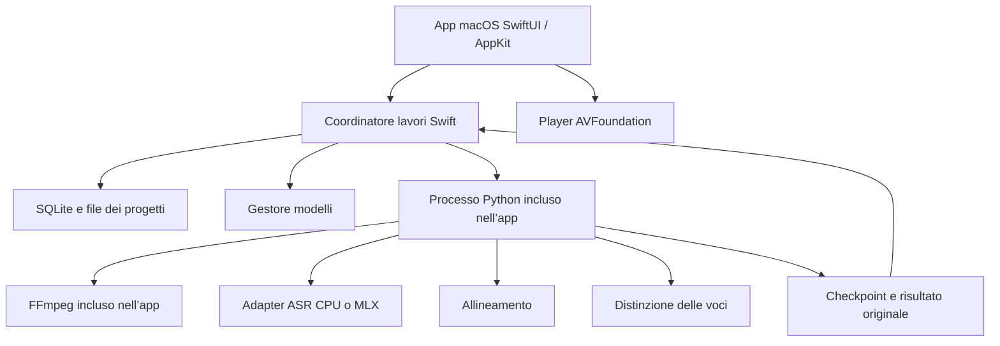

# WhisperX per macOS — progetto dell’app

Data: 9 ottobre 2026. Stato: proposta di prodotto e architettura, pronta per guidare l’implementazione. Questo documento non rappresenta un’app già compilata o distribuibile.

Prima implementazione disponibile in [`../macOS`](../macOS/README.md): bundle locale compilabile, libreria con anteprima, guida Hugging Face e worker di trascrizione. La build di sviluppo può usare l’ambiente Python locale. Il [sistema installer](../macOS/Packaging/README.md) include runtime autonomo e FFmpeg in un unico PKG; i modelli si scaricano al primo utilizzo. Restano le verifiche su Mac pulito, la distribuzione pubblica firmata/notarizzata e il gestore dedicato dei modelli. Vedere [verifica della UI](../macOS/VERIFICA_UI.md) per evidenze e limiti.

## Importazione e player — versione 0.5

La configurazione della trascrizione si apre in un pannello modale sopra la finestra, dopo aver scelto la posizione del file. Nuova trascrizione riapre lo stesso pannello e conserva il risultato precedente nella vista sottostante. Premendo Trascrivi il pannello si chiude, la finestra mostra lo stato del lavoro e passa al risultato quando è disponibile. La toolbar del player mantiene la posizione unica accanto a titolo e azioni, con più spazio verticale.

## Rifiniture UI — versione 0.4

Queste indicazioni aggiornano quelle della versione 0.3:

- Player nella stessa toolbar del titolo e del pulsante Importa, senza una barra separata sottostante.
- Impostazioni accessibili dal menu dell’app con Cmd+,; nessun pulsante nella schermata principale.
- Pannello dedicato denominato Hugging Face, insieme a Modelli e Libreria.
- Nuova cartella nel menu File con Cmd+Shift+N; nessun pulsante Nuova cartella nella sidebar.
- Cambio di posizione tramite spostamento dei dati, verifica della destinazione e rimozione del catalogo precedente, senza backup. Il ripristino in caso di errore conserva i dati; eventuali file non gestiti nella vecchia directory non vengono eliminati.
- Visualizzazione più compatta: distanza fra segmenti ridotta da 22 a 8 punti, padding verticale da 14 a 5 punti e distanza tra nome della voce e testo da 7 a 2 punti.

## Direzione UI aggiornata — versione 0.3

Le seguenti decisioni sostituiscono i punti iniziali su onboarding, finestra e archiviazione laddove divergono:

- Hugging Face compare esclusivamente nel pannello Voci delle Impostazioni. Nessun indicatore, bottone Configura le voci o wizard automatico nella finestra principale.
- Il titolo della finestra è il titolo del progetto, inizialmente derivato dal file e poi modificabile nell’app. Lo stesso titolo compare nella sidebar e nel player.
- La sidebar organizza progetti in cartelle e sottocartelle; il menu contestuale permette rinomina, spostamento e richiesta di eliminazione.
- Ogni importazione chiede se conservare il file nella sorgente o spostarlo fisicamente nella libreria. L’eliminazione segnala sempre la sorgente, conserva i file esterni e consente di scegliere se cestinare anche un file gestito.
- Le Impostazioni contengono Voci, Modelli con percorsi e dimensioni reali, e Libreria con posizione e possibilità di cambiarla. Il cambio di posizione conserva la vecchia libreria come backup.
- Il player si trova nella barra superiore secondo il riferimento Music fornito. Nella finestra non ci sono controlli audio duplicati.
- Dopo la trascrizione, la configurazione lascia spazio al menu delle trascrizioni del progetto, al selettore di visualizzazione e al testo. In alto a destra: Nuova trascrizione, Nomi delle voci quando applicabile ed Esporta.
- I nomi personalizzati delle voci sono salvati per trascrizione; il risultato raw del motore è conservato. La pagina finale di esportazione verrà definita successivamente.
- La prima persistenza implementata usa un catalogo JSON atomico, letto in background. La successiva evoluzione verso SQLite resta possibile senza esporla nel percorso utente.

## Obiettivo

Un’applicazione macOS installabile da un file DMG, trascinabile in Applicazioni e avviabile con doppio click. L’utente importa un audio o un video, seleziona la lingua e ottiene un testo modificabile con tempi e, facoltativamente, voci distinte.

Nessuna installazione manuale di Python, Homebrew, FFmpeg o pacchetti. Nessun Terminale nel percorso utente. Elaborazione sul Mac; Internet serve per scaricare i modelli e configurare le funzionalità che richiedono autorizzazioni.

Nome di lavoro: **WhisperX**. Nome pubblico, icona e identificatore dell’app da definire prima della distribuzione, evitando di presentare il prodotto come app ufficiale del progetto upstream.

## Situazione verificata

Il checkout `whisperXGUI`, commit `771b4a1`, contiene il pacchetto Python WhisperX e non contiene una GUI o un progetto Xcode. La CLI espone lingua, modelli, allineamento, distinzione delle voci ed esportazione. La conversione dei media usa l’eseguibile esterno FFmpeg.

Il motore di trascrizione corrente usa faster-whisper/CTranslate2. L’avvio seleziona CPU oppure CUDA; questo checkout non integra un backend MLX. La documentazione CTranslate2 elenca CPU ARM64 e x86-64 e GPU NVIDIA, quindi non basta passare `mps` alla CLI per accelerare tutto il processo su Mac. Fonte: [CTranslate2, hardware support](https://opennmt.net/CTranslate2/hardware_support.html).

Esiste inoltre lo script locale `/Users/marianialessandro/scripts/whisperx-apple-gpu.py`, con trascrizione MLX, allineamento MPS e checkpoint per fase. Può servire come riferimento per l’adapter Apple Silicon. La presenza dello script non prova la compatibilità con questo checkout né la distribuibilità delle sue dipendenze: entrambe richiedono verifiche dedicate. L’app distribuita non dipenderà da quel percorso personale.

## Percorso principale

1. Scaricare il DMG, trascinare l’app in Applicazioni e aprirla.
2. Al primo avvio, l’app verifica compatibilità e spazio disponibile e propone di scaricare il modello consigliato. Mostra dimensione effettiva, avanzamento e possibilità di riprovare.
3. Trascinare un file nella finestra oppure usare **Aggiungi file…**.
4. Scegliere la lingua, lasciando **Rileva automaticamente** se sconosciuta. Attivare eventualmente **Distingui le voci**.
5. Premere **Trascrivi**. Il lavoro entra nella coda e mostra la fase in corso.
6. Ascoltare, correggere il testo e assegnare nomi alle voci.
7. Premere **Esporta…** e scegliere formato e destinazione.

Durante la configurazione iniziale proporre **Prepara anche le voci**, con la possibilità di scegliere **Più tardi**. Lo stesso percorso si apre quando si attiva **Distingui le voci** senza averlo ancora configurato. Un utente che vuole una trascrizione semplice non deve creare un account.

## Finestra e linguaggio visivo

Interfaccia nativa SwiftUI con integrazioni AppKit per drag-and-drop, menu e finestre di sistema. Aspetto macOS, toolbar standard, SF Symbols, tema chiaro e scuro, navigazione da tastiera e VoiceOver. Italiano iniziale; tutte le stringhe predisposte per la localizzazione.

La finestra principale usa una sidebar e un’area di lavoro. Dimensione iniziale proposta: 1180 × 780 punti; minimo 900 × 600. Sui display piccoli le impostazioni diventano un pannello richiudibile.

| Area | Contenuto e comportamento |
| --- | --- |
| Sidebar | Tutte le trascrizioni, In coda, Completate; elenco con titolo, durata e stato. |
| Toolbar | Aggiungi file, ricerca nelle trascrizioni, Esporta per il progetto selezionato. |
| Nuovo lavoro | Nome e durata del media, lingua, qualità, Distingui le voci, pulsante Trascrivi. |
| Lavoro in corso | Fase corrente, avanzamento quando disponibile, tempo trascorso, Annulla. |
| Risultato | Player, trascrizione con tempi e voci, ricerca nel testo, modifica ed esportazione. |
| Impostazioni | Modelli scaricati, spazio occupato, accesso per le voci, impostazioni avanzate. |

Terminologia utente: **Voci**, **Precisione dei tempi**, **Qualità**, **Parole e nomi da riconoscere**. Termini come diarizzazione, batch size e compute type restano nei dettagli tecnici.

Lo stato vuoto contiene una sola azione evidente: **Trascina qui un audio o un video**, con il pulsante **Scegli file…**. Niente dashboard o configurazioni tecniche prima di poter importare.

## Impostazioni di trascrizione

| Controllo | Valore iniziale | Regola |
| --- | --- | --- |
| Lingua | Rileva automaticamente | Italiano e lingue recenti facilmente raggiungibili. |
| Qualità | Bilanciata | Profili Rapida, Bilanciata, Massima; ogni profilo indica modello e dimensione prima del download. |
| Distingui le voci | Disattivato | Non blocca la trascrizione semplice. |
| Numero di voci | Automatico | Opzione Numero noto con un intero positivo; in modalità automatica nessun massimo arbitrario. |
| Precisione dei tempi | Attiva, se supportata | In assenza di modello per la lingua, offrire trascrizione con tempi di segmento. |
| Parole e nomi da riconoscere | Vuoto | Suggerimenti, senza promettere che compariranno nel testo. |

Il modello iniziale non viene scelto soltanto in base alla RAM: la matrice di release deve misurare qualità e tempi su hardware rappresentativo. Il profilo Massima su Apple Silicon punta a Whisper large-v3 completo tramite MLX, subordinato alla verifica dell’adapter. I profili CPU possono usare modelli più piccoli e int8. Nessun cambio silenzioso di profilo durante il lavoro.

Le opzioni beam size, batch size e precisione numerica compaiono soltanto nel pannello Avanzate. Le combinazioni incompatibili vengono impedite prima dell’avvio. La traduzione verso l’inglese è successiva alla prima release, perché il percorso corrente disabilita l’allineamento per la traduzione.

## Configurazione delle voci

Il modello `pyannote/speaker-diarization-community-1` richiede l’accettazione delle condizioni e un token Hugging Face. Fonte: [istruzioni del modello](https://huggingface.co/pyannote/speaker-diarization-community-1).

Decisione di prodotto: non è disponibile un hosting proprietario per i modelli. Il download avviene direttamente da Hugging Face con le credenziali dell’utente. L’app accompagna la configurazione una sola volta e automatizza verifica, salvataggio e download.

### Configurazione guidata

Un pannello dedicato, leggero e con molto spazio, mostra il titolo **Prepariamo le voci** e il testo **Bastano pochi passaggi. Poi potrai distinguere le voci direttamente sul tuo Mac.** Nessun limite di tempo promesso: registrazione e verifica dell’email dipendono dal sito.

Tre passaggi con indicatore discreto **1 di 3**, una sola azione principale per schermata e un link **Più tardi** sempre disponibile. I passaggi si possono rivedere senza perdere lo stato non sensibile.

| Passaggio | Testo e azioni |
| --- | --- |
| 1 — Il tuo account | **Crea un account gratuito su Hugging Face. Se ne hai già uno, accedi.** Pulsanti **Apri Hugging Face** verso `https://huggingface.co/join` e **Ho già un account** verso `https://huggingface.co/login`. La registrazione e l’eventuale verifica email avvengono nel browser. |
| 2 — Abilita il modello | **Apri la pagina del modello e accetta le condizioni con il tuo account.** Pulsante **Apri la pagina del modello**. Spiegare che il sito può chiedere informazioni di contatto: l’app non accetta condizioni per conto dell’utente. |
| 3 — Collega l’app | **Crea un token di tipo Read, copialo e incollalo qui. Serve a scaricare i modelli per le voci.** Pulsante secondario **Crea il token** verso `https://huggingface.co/settings/tokens`, suggerimento nome **WhisperX Mac**, campo protetto e pulsante principale **Collega e continua**. |

Il pulsante **Continua** nei primi due passaggi indica che l’utente ha seguito le istruzioni, senza fingere di avere verificato il browser. La verifica effettiva delle credenziali e dell’accesso al modello avviene dopo aver incollato il token. Non richiedere permessi di scrittura. Fonte sui tipi di token: [Hugging Face, User Access Tokens](https://huggingface.co/docs/hub/security-tokens).

### Schermata del token

La schermata mostra una card centrale con icona di collegamento, titolo **Collega Hugging Face**, una breve istruzione e un solo campo **Token Hugging Face**, con placeholder **Incolla qui il token**. Campo mascherato per impostazione iniziale, controllo accessibile **Mostra/Nascondi** e pulsante **Incolla** che legge gli appunti esclusivamente dopo il click dell’utente. Consentire anche Cmd+V; non leggere o modificare automaticamente gli appunti.

Sotto il campo: **Il token viene salvato nel Portachiavi del Mac. Audio e video vengono elaborati sul tuo computer.** Il testo evita promesse assolute sull’assenza di traffico di rete: accesso e download contattano Hugging Face.

Il campo e il pulsante principale devono essere chiaramente visibili senza scorrere. Usare colori di sistema, angoli arrotondati moderati, niente gergo tecnico, badge superflui o campi per URL, cartelle e parametri. Dopo l’incollaggio rimuovere soltanto gli spazi iniziali e finali; non stampare il valore e non considerare il semplice prefisso una prova di validità.

Alla pressione di **Collega e continua**, disabilitare gli invii duplicati e mostrare **Verifico il collegamento…**. Verificare l’identità del token e l’accesso a tutte le risorse protette necessarie, quindi salvarlo nel Portachiavi. In caso di errore lasciare la schermata aperta e il valore soltanto in memoria per consentire la correzione; non serializzarlo nello stato del wizard.

| Esito | Messaggio e recupero |
| --- | --- |
| Credenziali non valide | **Questo token non funziona. Controlla di averlo copiato per intero oppure creane uno nuovo.** Azione **Apri i token**. |
| Accesso al modello negato | **Non riesco ancora ad accedere al modello delle voci. Controlla le condizioni del modello e i permessi del token.** Azioni **Apri il modello**, **Apri i token** e **Riprova**. Non dedurre automaticamente la causa da un solo codice HTTP. |
| Rete assente o timeout | **Non riesco a collegarmi a Hugging Face. Controlla la connessione e riprova.** Conservare temporaneamente il campo senza dichiarare il token errato. |
| Portachiavi non disponibile | **Non riesco a salvare il collegamento nel Portachiavi. Riprova per completare la configurazione.** Nessun salvataggio alternativo in chiaro. |
| Verifica riuscita | **Collegato! Prepariamo i modelli per le voci.** Mostrare download, dimensione e avanzamento effettivi. |

Verifica del token e download hanno stati separati. Se il download fallisce, conservare il collegamento valido e offrire **Riprendi download** senza far ripetere registrazione e creazione del token. Mostrare **Le voci sono pronte** soltanto dopo aver verificato tutte le risorse. A configurazione conclusa eliminare il valore del token dallo stato della UI.

Nelle Impostazioni mostrare soltanto **Hugging Face: collegato**, con azioni **Sostituisci token** e **Scollega**. Scollega rimuove le credenziali dal Portachiavi senza eliminare trascrizioni e modelli già scaricati. La guida può essere riaperta dalla stessa pagina. Il token non viene richiesto nuovamente al riavvio.

Non includere un token condiviso nell’app. Modelli protetti scaricati per l’utente dopo l’autorizzazione; verificare anche le dipendenze del modello. Una volta preparate tutte le risorse, la modalità offline deve essere validata senza rete.

I risultati mostrano **Voce 1**, **Voce 2**, ecc. L’utente può rinominarle e correggere l’attribuzione di un segmento. La separazione delle voci non identifica automaticamente le persone; i segmenti senza attribuzione restano visibili come **Voce non assegnata**.

## Revisione ed esportazione

Il click sul tempo di un segmento sposta il player. Il segmento riprodotto viene evidenziato. Il player espone riproduzione, pausa, salto di cinque secondi e velocità. Anteprima video soltanto per formati riproducibili da AVFoundation; la trascrizione può supportare più formati tramite FFmpeg.

Modifica inline del testo, salvataggio automatico, undo/redo e rinomina delle voci. Conservare separatamente risultato originale del motore e correzioni. Nella prima release non modificare manualmente i tempi.

Una correzione del testo non rigenera automaticamente i tempi delle singole parole: invalida l’allineamento delle parole del segmento modificato. L’esportazione SRT/VTT usa i tempi di segmento; un’eventuale futura esportazione con parole evidenziate richiede riallineamento.

Esportazioni iniziali: TXT, SRT, VTT, JSON. TXT con opzioni per tempi e nomi delle voci; SRT/VTT con regole per lunghezza delle righe; JSON con versione dello schema, tempi disponibili e correzioni. Conservare il JSON raw compatibile con WhisperX come esportazione tecnica separata. File con nomi uguali non vengono sovrascritti senza scelta esplicita.

## Architettura

L’app Swift possiede UI, credenziali, coda, persistenza, editor ed esportazione. Un processo Python separato possiede l’inferenza. Il crash del motore lascia aperta la finestra e recuperabili i lavori. Nella prima release avviare un solo lavoro di inferenza alla volta, anche se sono importati più file.

Integrare le API Python attraverso un entrypoint dedicato dell’app, mantenendo CLI e API esistenti compatibili. Non costruire la GUI interpretando messaggi testuali della CLI e non avviare una shell. Se si estende uno script esistente, aggiungere soltanto flag opzionali e aggiornare l’help.

Il coordinatore avvia l’interprete incluso tramite percorso assoluto. Il worker riceve configurazione versionata tramite stdin e produce eventi JSON Lines su stdout; stderr è riservato ai log. Le librerie che stampano testo vanno redirette su stderr per non corrompere il protocollo. Nessun server HTTP locale necessario.

Eventi: `ready`, `stage_started`, `progress`, `checkpoint_saved`, `warning`, `completed`, `failed`. Ogni evento contiene versione, ID del lavoro e fase; i progressi includono unità e totale solo quando misurabili. Il processo Swift verifica ordine, identità e schema. Un file di risultato viene reso disponibile soltanto dopo scrittura atomica e validazione.

Passare il token al worker mediante il canale privato del processo, senza inserirlo negli argomenti del comando, nei file di configurazione o nei log. Usare un ambiente controllato; non ereditare le installazioni Python dell’utente. La risoluzione di FFmpeg deve puntare al binario incluso e propagarsi alle librerie che ne dipendono.

## Motori e piattaforme

Target proposto: macOS 14 o successivo, prima distribuzione Apple Silicon. Il minimo effettivo deve essere confermato sulle dipendenze binarie incluse. Intel è un target successivo, con runtime e pacchetto propri dopo la verifica della disponibilità delle dipendenze; non dichiarare universalità senza una build x86-64 funzionante.

| Percorso | Ruolo | Condizione di disponibilità |
| --- | --- | --- |
| CTranslate2 CPU | Baseline e compatibilità del checkout | Test dell’intera pipeline nel runtime distribuito. |
| MLX/Metal ASR | Percorso preferito Apple Silicon | Adapter integrato, modelli verificati e prove reali su GPU. |
| Allineamento MPS | Accelerazione proposta su Apple Silicon | Supporto delle operazioni e regressioni per lingua verificati. |
| Pyannote MPS | Accelerazione proposta per le voci | Compatibilità e stabilità della pipeline verificate. |

Separare backend ASR, dispositivo di allineamento e dispositivo delle voci. Mostrare nei dettagli di ogni lavoro il percorso effettivamente usato. Se una fase accelerata fallisce, proporre di riprovare quella fase su CPU mantenendo i checkpoint compatibili. Nessuna dicitura GPU basata soltanto sulla presenza del chip.

Lo script Apple GPU esistente serve a ridurre il lavoro di ricerca, ma richiede estrazione di logica, gestione delle credenziali e configurazione facoltativa delle voci prima dell’integrazione.

## Coda, checkpoint e recupero

Stati persistenti: In attesa, Preparazione, Trascrizione, Allineamento, Distinzione delle voci, Completato, Completato con avvisi, Errore, Annullato, Interrotto. Non confondere annullamento volontario e crash.

Checkpoint atomici dopo decodifica, trascrizione, allineamento e voci. Il manifest include impronta dell’input, parametri, versioni del worker e modelli con revisioni. Una modifica ai parametri invalida soltanto le fasi dipendenti; cambiando il numero di voci si può riutilizzare ASR e allineamento compatibili.

Il recupero avviene dall’ultima fase completata: non promettere ripresa a metà di una fase. Nessun pulsante Pausa nella prima release. Annulla termina il worker e i processi figli, conserva i checkpoint completi ed elimina gli output parziali non validi.

Se una fase opzionale fallisce, rendere disponibile la trascrizione riuscita e offrire **Riprova questa fase**. Se mancano modelli, il lavoro resta in attesa di risorse. Al riavvio, i lavori rimasti attivi diventano Interrotti e l’app propone il recupero senza avviare automaticamente elaborazioni pesanti.

Per le fasi senza progresso misurabile mostrare indicatore indeterminato e tempo trascorso. Le stime di completamento arrivano soltanto dopo misurazioni sufficienti sul dispositivo; niente percentuali inventate o promesse di velocità derivate dai benchmark CUDA upstream.

## Dati e gestione delle risorse

Usare `Application Support` tramite le API di sistema. Archivio SQLite per lavori, stato e correzioni; directory separate per modelli, progetti e checkpoint. I temporanei rigenerabili risiedono in `Caches`. I modelli persistenti non vanno trattati come cache eliminabile automaticamente.

Importazione predefinita tramite copia gestita, con controllo dello spazio prima di copiare. In Avanzate, consentire il riferimento al file originale per media grandi; se viene spostato, proporre **Ricollega file…** e verificare l’identità prima di riutilizzare checkpoint. Cancellare un progetto non elimina il media originale esterno.

Ogni lavoro usa un UUID, non il nome del media come chiave. I download dei modelli avvengono in staging con manifest completo e verifica di integrità dove disponibile; una risorsa diventa Pronta soltanto dopo la verifica di tutti i file necessari. Gestire anche VAD, allineamento per lingua e risorse di tokenizzazione, non soltanto Whisper.

La pagina Modelli mostra spazio occupato, stato e lavori che richiedono ciascuna risorsa. Non cancellare un modello in uso. Una risorsa mancante o corrotta offre **Scarica di nuovo**. In modalità offline impedire download impliciti da qualsiasi componente.

Durante un’elaborazione attiva impedire lo stop automatico del sistema con le API macOS previste, rilasciando l’asserzione a fine lavoro; non impedire lo stop richiesto dall’utente. La chiusura della finestra può lasciare attiva la coda, indicandolo chiaramente; l’uscita dall’app durante un lavoro richiede la scelta tra restare aperta e interrompere.

## Packaging e distribuzione

DMG contenente `WhisperX.app` e il collegamento ad Applicazioni. Il bundle include interfaccia nativa, runtime Python privato, worker, dipendenze native e FFmpeg. I pesi dei modelli vengono scaricati al primo utilizzo. Non eseguire `pip install` sul Mac dell’utente e non modificare il bundle dopo la firma.

Versioni bloccate e build riproducibile per architettura; verificare percorsi relocabili e librerie dinamiche su un Mac privo di ambiente di sviluppo. Includere licenze e attribuzioni delle librerie, del build FFmpeg scelto e dei modelli. Il pacchetto attuale non basta a garantire che tutte le dipendenze siano redistribuibili con la stessa configurazione.

Per la distribuzione pubblica: firma Developer ID dei componenti eseguibili, Hardened Runtime con sole eccezioni motivate, notarizzazione e ticket allegato. Provare il DMG realmente scaricato su un Mac con Gatekeeper attivo. Fonte: [Apple, distribuzione con Developer ID](https://developer.apple.com/developer-id/).

La prima distribuzione avviene fuori dal Mac App Store; la sandbox non è un requisito assunto per questa release. Una futura pubblicazione sullo Store richiede una verifica specifica di sandbox, accesso ai file e runtime. Gli aggiornamenti iniziali possono essere DMG sostitutivi, preservando dati e modelli; l’aggiornamento automatico è successivo.

## Ordine di realizzazione

1. **Prova di distribuzione:** creare un piccolo bundle con runtime, FFmpeg e pipeline CPU completa; provarlo su un Mac senza Python/Homebrew. In parallelo tecnico, verificare l’adapter MLX su questo checkout. Questa fase stabilisce architetture e minimo macOS realmente supportabili.
2. **Percorso completo:** finestra nativa, importazione, configurazione minima, un lavoro, progressi per fase, salvataggio ed esportazione. Alla fine deve essere possibile completare una trascrizione attraverso la GUI.
3. **Risorse e voci:** download controllato di tutti i modelli, Portachiavi, guida Hugging Face, distinzione delle voci e modalità offline verificata. Integrare MLX soltanto dopo la prova del punto 1.
4. **Uso quotidiano:** coda persistente, checkpoint, recupero, player, correzioni, ricerca e gestione dello spazio.
5. **Release:** accessibilità, localizzazione, test su hardware rappresentativo, firma, notarizzazione, DMG e prova del primo avvio da download.

La prova CPU del punto 1 è una base tecnica; la scelta del percorso predefinito pubblico si decide dopo benchmark reali. Se MLX non supera le verifiche, l’app può distribuire il percorso CPU dichiarandone i limiti di prestazione, senza presentarlo come accelerato.

## Criteri di accettazione

- Su un Mac pulito, installazione e prima trascrizione avvengono senza Terminale, Python o Homebrew.
- Primo download interrotto, rete assente e spazio insufficiente hanno percorsi di recupero comprensibili.
- Un MP3, un M4A e un video MP4 con audio vengono importati, trascritti e riprodotti; file corrotti o senza audio non mandano in crash l’app.
- File con spazi, accenti, nomi uguali e percorsi lunghi restano distinti e gestiti correttamente.
- Un audio italiano, uno inglese e un audio senza parlato verificano lingua, tempi e assenza di risultati fittizi. Un campione di riferimento con voci annotate serve a valutare la diarizzazione.
- Modifica del testo, rinomina delle voci e riavvio dell’app preservano le correzioni; TXT/SRT/VTT esportati le riflettono.
- Annullamento e terminazione forzata non lasciano processi di inferenza attivi o checkpoint dichiarati completi quando sono parziali.
- Disconnettendo la rete dopo aver preparato le risorse, trascrizione e distinzione delle voci funzionano localmente senza download impliciti.
- Token assente o accesso negato alle voci non impediscono di trascrivere senza voci; credenziali assenti da log, argomenti dei processi ed esportazioni.
- La guida consente a una persona senza account di raggiungere registrazione, condizioni e creazione del token usando i pulsanti dell’app; incollaggio tramite pulsante e Cmd+V entrambi supportati, senza lettura automatica degli appunti.
- Token errato, accesso negato, rete assente e mancato salvataggio nel Portachiavi hanno messaggi e azioni di recupero dedicati. Un download interrotto dopo il collegamento non richiede un nuovo token.
- Un audio lungo e un Mac con poca memoria disponibile verificano gestione dei picchi, coda seriale e recupero. Tempi e consumo di memoria vengono registrati, senza soglie di velocità inventate prima delle misurazioni.
- VoiceOver, navigazione da tastiera, tema scuro e testo ingrandito consentono di completare il percorso principale.
- DMG finale firmato e notarizzato verificato tramite primo avvio da un download reale con Gatekeeper attivo.

## Confini della prima release

Include importazione di file locali, trascrizione, allineamento, voci facoltative, revisione, coda ed esportazione. Registrazione dal microfono, download YouTube, riassunti AI, traduzione, sincronizzazione cloud e collaborazione sono estensioni successive. Il prodotto iniziale concentra il lavoro sull’esperienza completa di trascrizione locale.
